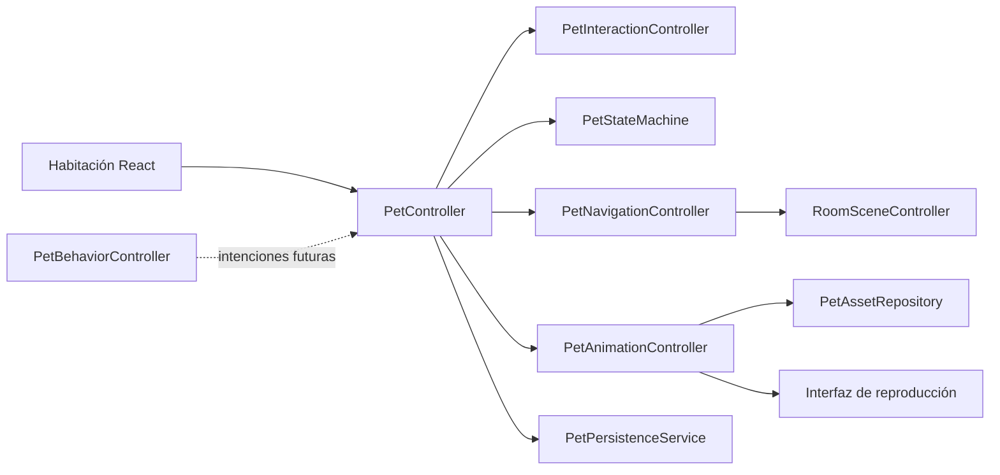

# Auditoría de PetMotion2D · Huellitas de Luz 2.0

22 de noviembre de 2026 · Fase 0 · Árbol de trabajo de `master` sobre `6754df5`

## 1. Diagnóstico técnico

Huellitas de Luz 2.0 es un monorepo web con React y TypeScript en el navegador, una API ASP.NET Core y PostgreSQL. El repositorio carece de `pubspec.yaml`, código Dart y módulos Flutter. PetMotion2D puede incorporarse como una función de la web actual. Para el MVP propongo una ruta `/habitacion` que carga bajo `SiteLayout` y utiliza los recursos del creador mediante un adaptador. El Golden Retriever sería una mascota de demostración local, identificada como tal en la interfaz.

El proyecto de Patitas Tech busca acercar a las personas a refugios autorizados, promover la adopción responsable y otorgar una mascota virtual por cada donación confirmada. La portada y el creador funcionan hoy. La galería de adopciones, los pagos, la colección asociada a una cuenta y el jardín interactivo aparecen como entregas previstas. La habitación permite validar el cuidado de una mascota sin dar de alta una adopción, registrar una donación ni otorgar una mascota a una cuenta. [README](../README.md) · [Arquitectura y fases](arquitectura.md)

| Área | Versiones y herramientas comprobadas |
| --- | --- |
| Web | React y React DOM 19.3.1, TypeScript 5.9.3 en modo estricto, Vite 8.3.8 y Tailwind CSS 4.3.5, según `package-lock.json`. Lucide 1.75.0 y Manrope y Fraunces 5.3.0 mediante Fontsource. |
| Entorno web | Node.js 24.14.1 y npm 11.21.2 en el equipo. El proyecto admite Node 22.12 o posterior de la serie 22, o Node 24 en adelante. |
| API y datos | C# sobre `net10.0`, ASP.NET Core, EF Core e Identity 10.0.12, Npgsql EF 10.0.3 y PostgreSQL 17 en Compose. Se encontraron los SDK .NET 10.0.300 y 10.0.401. |
| Pruebas y gráficos | Playwright 1.65.1, xUnit 2.9.3, Sharp 0.35.5 y libvips 8.18.7. |

[Dependencias web](../apps/web/package.json) · [Lockfile](../package-lock.json) · [Proyecto API](../apps/api/Huellitas.Api.csproj) · [Proyecto de pruebas](../tests/Huellitas.Api.Tests/Huellitas.Api.Tests.csproj) · [Compose](../docker-compose.yml)

## 2. Arquitectura y funcionalidades actuales

| Componente | Cómo funciona hoy |
| --- | --- |
| Navegación | `main.tsx` compara `window.location.pathname` con `/creador` y muestra la portada en los demás casos. `SiteLayout` compone cabecera, menú adaptable, enlace para saltar al contenido y pie. Los enlaces de adopciones, refugios y jardín apuntan a secciones de la portada. El enrutamiento usa enlaces HTML y carece de un router instalado. |
| Portada | Presentación en español, llamadas a las secciones, preguntas frecuentes y acceso al creador desde el jardín. Los tokens visuales y tipografías viven en `styles/global.css`. |
| Creador | Elige entre nueve variantes de perro y nueve de gato. Valida el nombre y permite ajustar el tono de piel o pelaje y elegir un collar. Conserva el borrador en estado React entre edición y revisión. La vista previa ofrece entre 12 y 14 movimientos por variante, reproducción, pausa y preferencia de movimiento reducido. |
| Animación actual | `catalog.ts` traduce el manifiesto a variantes, pistas y URLs. `PetPreview.tsx` carga el atlas según la acción y usa `requestAnimationFrame`. `motion.ts` resuelve el fotograma según el tiempo, conserva duraciones de GIF y sostiene el fotograma final de las acciones de una ejecución. `PetSprite.tsx` dibuja el arte y la máscara del collar. |
| API | Monolito modular con `Controllers`, `Domain`, `Persistence` e `Infrastructure`. Expone `GET /api/v1/platform`, `GET /health/live` y `GET /health/ready`. Vite reenvía `/api` a la API local durante el desarrollo. |
| Datos y autenticación | `HuellitasDbContext` y la migración `20261118072458_InitialIdentity` definen usuarios, roles y tablas auxiliares de Identity. La migración siembra `Usuario`, `Administrador` y `RefugioAutorizado`. Quedan pendientes los endpoints de registro y sesión, el modelo de mascota, el jardín y la persistencia ligada a cuentas. |
| Almacenamiento y servicios | Compose define PostgreSQL local con volumen. En la web no encontré un servicio de almacenamiento, uso de `localStorage` o IndexedDB ni una API del creador. Los pagos pey/CoDi, SignalR y Railway figuran como planes. |

[Entrada web](../apps/web/src/main.tsx) · [Navegación](../apps/web/src/layouts/SiteLayout.tsx) · [Portada](../apps/web/src/pages/HomePage.tsx) · [Creador](../apps/web/src/pages/PetCreatorPage.tsx) · [Arranque API](../apps/api/Program.cs) · [Contexto de datos](../apps/api/Persistence/HuellitasDbContext.cs) · [Contrato HTTP](api.md)

## 3. Recursos reutilizables y brechas artísticas

- **Personaje y representación.** El manifiesto del árbol de trabajo lista 18 variantes y 775 fotogramas. Verifiqué la presencia de los atlas y máscaras declarados, los rangos de fotogramas y la consistencia de las duraciones. `PetSprite` y el muestreo temporal de `motion.ts` aportan una base reutilizable. La habitación necesita un ancla propia en el suelo y un reloj de locomoción ligado al desplazamiento. Los rebotes y desplazamientos de vista previa se mantendrían en el creador. [Catálogo](../apps/web/src/features/pets/catalog.ts) · [Muestreo](../apps/web/src/features/pets/motion.ts) · [Sprite](../apps/web/src/features/pets/PetSprite.tsx) · [Manifiesto](../apps/web/src/assets/pets/manifest.json)
- **Proceso de arte.** `scripts/pets/prepare.mjs` limpia fondos, alinea fotogramas, crea máscaras y escribe atlas WebP y manifiesto. `sources.mjs` registra los recortes y los GIF integrados. La auditoría leyó esos recursos sin regenerarlos porque el script escribe en el directorio de atlas, que ya contiene cambios locales. [Preparación](../scripts/pets/prepare.mjs) · [Fuentes](../scripts/pets/sources.mjs) · [Recursos gráficos](recursos-graficos.md)
- **Golden Retriever.** El atlas detallado ofrece marcha (6 fotogramas), sentado (4), sueño (3), despertar (4), comer (5), beber (5) y otras pistas. Los GIF integrados son reposo (9), carrera (16) y salto (12). En `Imagenes/Golden_retriver/` también están los originales de marcha (12), giro (16), sentado (12), sueño (12) y despertar con estiramiento (16). Sharp leyó sus fotogramas, tiempos y metadatos de transparencia. Estos últimos cinco GIF son candidatos de producción. Hay que revisar orientación, puntos de apoyo, silueta y continuidad antes de usarlos en la habitación. Las pistas del catálogo carecen de clips dedicados para detenerse y levantarse. [Fuentes del Golden](../scripts/pets/sources.mjs) · [GIF del Golden](../Imagenes/Golden_retriver/)
- **Habitaciones.** Los siete PNG de `Imagenes/escenarios/` coinciden byte por byte con los que `HEAD` registra en `Imagenes/` y se acercan a 16:9. Revisé visualmente `04_Sala_de_descanso.png` (1672 × 941). Tiene animales, camas y una mesa dibujados en la misma capa que el suelo. Sirve como referencia visual. Para el MVP propongo una escena simplificada con objetos independientes y los colores del sitio. El fondo definitivo necesita una zona transitable despejada y piezas separadas para oclusión y colisiones. [Sala de descanso](../Imagenes/escenarios/04_Sala_de_descanso.png)
- **Rig y direcciones.** No encontré archivos `.riv` o `.rev`, piezas articuladas ni un conjunto validado de vistas direccionales. Un GIF de giro puede aportar poses candidatas. La validación debe determinar si muestra la secuencia requerida de cabeza, patas delanteras y traseras, cuerpo y estabilización. Las vistas frontal, laterales, trasera e intermedias, así como la fijación precisa de patas, quedan sujetas al arte disponible. El MVP puede marcar los estados con poses aproximadas y rótulos de prototipo donde falten recursos.
- **Árbol de trabajo.** Ya había cambios en el creador, documentación, pruebas y atlas, así como GIF y escenarios sin seguimiento en Git. El diagnóstico refleja esta copia local. La disponibilidad de esos recursos en otra copia depende de que queden versionados.

## 4. Integración de PetMotion2D

La página React monta la habitación, traduce los gestos y presenta los controles accesibles. `PetController` recibe intenciones, coordina la simulación y entrega la posición, postura y animación a la vista. Las reglas de navegación y transición viven en TypeScript y se pueden ejecutar con un reloj de prueba. El controlador de animación consume una interfaz de reproducción que acepta atlas en el MVP y podría aceptar Rive cuando haya un rig y se valide su integración web.



| Componente | Responsabilidad propuesta |
| --- | --- |
| `PetController` | Ciclo de vida, reloj de simulación, cola de intenciones, coordinación entre estado, recorrido y animación. |
| `PetStateMachine` | Jerarquía de postura, locomoción, emoción y acción contextual. Usa guardas explícitas y compromete la postura final al completar la transición. |
| `PetAnimationController` | Elige clips, fases, orientación y velocidad. Gestiona prioridades, interrupciones, pose final y un fallback con finalización predecible cuando falta un clip. |
| `PetBehaviorController` | Fase posterior. Programa intenciones ponderadas con intervalos configurables, pausa y respeto a la interacción del usuario. Consume las mismas órdenes que la interfaz. |
| `PetNavigationController` | Selección de destino, ruta por waypoints, pruebas de paso libre, velocidad, aceleración, frenado y orientación. |
| `PetInteractionController` | Traduce eventos de suelo, objeto y contacto con la mascota en intenciones. Encadena aproximación, detención, orientación y acción. |
| `PetAssetRepository` | Resuelve recursos y capacidades de un `AnimationSet`, valida disponibilidad y entrega poses de respaldo. Adapta el catálogo actual del Golden. |
| `RoomSceneController` | Fuente de límites, suelo transitable, orden de profundidad y objetos. Cada objeto declara ID, posición, dimensiones, colisión, área táctil, punto de interacción y acciones. |
| `PetPersistenceService` | Carga, valida y guarda una instantánea versionada mediante un adaptador de almacenamiento. |

### Escena y movimiento

- Usar un plano lógico de **1280 × 720** y escalarlo uniformemente. Calcular la coordenada lógica del puntero a partir del rectángulo visible y excluir las bandas exteriores. El escenario tendría controles HTML para teclado, con una alternativa para dar órdenes de desplazamiento y activar objetos.
- Declarar `Background`, `FurnitureBackground`, `InteractiveObjects`, `PetCharacter`, `Foreground` e `InterfaceOverlay`. Dentro de la zona donde pueden cruzarse, mascota y objetos comparten un orden estable basado en la Y del ancla al suelo. Los muebles de primer plano pueden ocluir al personaje. La escala de perspectiva se aplica alrededor de sus patas.
- Delimitar el suelo con un polígono y calcular rutas sobre un grafo pequeño de waypoints más los puntos de inicio, destino e interacción. Comprobar cada segmento contra el suelo y los obstáculos ampliados por la huella del personaje. Validar también el segmento recorrido por paso de simulación. Un destino bloqueado admite un punto cercano alcanzable o un aviso si no existe ruta.
- Alimentar la simulación con `deltaTime`, subdividir los saltos de tiempo y reiniciar el reloj al volver a la pestaña. Frenar antes del waypoint final, limitar el paso a la distancia restante y ligar la fase de marcha a la distancia recorrida. Cuando haya datos suficientes, anotar apoyos por fotograma y calibrar la longitud de zancada. Validar el deslizamiento visual antes de declarar lograda la fijación de patas.
- Usar poses direccionales aprobadas al girar. Si faltan, usar una pose fija provisional mientras se detiene y se prepara el siguiente tramo. El cuerpo entero carecerá de rotación CSS para simular ese gesto.

### Estados, activos y persistencia

- **Estados del MVP.** Soportar `Standing`, `Sitting`, `Lying` y `Sleeping`, con `Idle`, `Walking`, `Turning` y `Stopping`, y las acciones `Eating` y `Drinking`. `Airborne`, trote, carrera y acciones adicionales se habilitan al tener sus guardas y activos. Un pedido de marcha desde sentado requiere `stand_up`. Desde sueño, exige despertar y alcanzar una postura de pie. Comer y beber requieren estar detenido y en el punto de interacción válido. La intención del usuario prevalece sobre el futuro comportamiento autónomo. Al cambiar de destino, se cancela la aproximación anterior. Una transición física comprometida llega a una pose estable antes de atender la última intención pendiente.
- **Clips y especies.** Definir un contrato con ID, nombre, duración, loop o one-shot, posturas, prioridad, interrupción, eventos, transiciones admitidas, vistas y recursos. Las acciones prolongadas pueden declarar `enter`, `loop` y `exit`. El MVP declara solo las acciones que consume. El catálogo de 24 acciones vendrá después de su validación. La definición de mascota reúne identificador de instancia, especie, raza, familia de rig, `AnimationSet`, activos y configuración de movimiento. Cada instancia mantiene su estado y posición. `canine_v1` y `feline_v1` tendrán sus propias proporciones y pistas. Comparten identificadores de acciones y reglas de navegación.
- **Rig posterior.** Modelar raíz, pelvis, columna, pecho, cuello y cabeza con mandíbula, ojos y orejas, cuatro cadenas de patas y una cola de tres segmentos. Incluir pivotes, hombros, codos, caderas, rodillas, corvejones y anclas de patas para probar interpolación, mezcla de pistas, animación secundaria y cinemática inversa. El Golden de atlas valida la integración de escena y comportamiento mientras se preparan las ilustraciones articuladas.
- **Guardado del MVP.** Ante la ausencia de almacenamiento web existente, usar `localStorage` por origen, con una clave propuesta `huellitas.petmotion2d.v1`. Guardar mascota, escena, posición lógica, postura estable, emoción y preferencias en puntos de cambio y al ocultar la página. Validar versión, IDs, coordenadas, límites y colisiones al restaurar. Si se cerró en movimiento, iniciar en `Idle` con la última posición válida y una postura coherente. Ante datos dañados o almacenamiento inaccesible, usar el punto inicial y permitir jugar en memoria. La colección y el futuro guardado en servidor se vincularán al modelo de cuentas cuando esté disponible.

## 5. Archivos y dependencias previstos

```text
apps/web/src/
  main.tsx                                      # Modificar · reconocer /habitacion y cargar la página bajo demanda
  layouts/SiteLayout.tsx                        # Modificar · estado de ruta y destino del enlace del pie
  pages/
    HomePage.tsx                                # Modificar · enlazar la demo desde la sección del jardín
    PetRoomPage.tsx                             # Nuevo · entrada de la habitación bajo el layout actual
  features/
    pets/                                       # Reutilizar · catálogo, sprites y muestreo temporal
    pet-motion-2d/
      domain/                                   # Estado, contratos de animación y navegación
      controllers/                              # Coordinación, interacción, escena y animación
      adapters/                                 # Atlas existente y localStorage
      scene/                                    # Datos de la habitación y componentes React
  styles/
    pet-room.css                                # Nuevo · estilos de escena y controles con los tokens del sitio
  assets/pet-motion-2d/                         # Nuevo si hay arte de escena o pistas aprobadas para el MVP
tests/e2e/pet-room.spec.ts                      # Nuevo · integración en el navegador
tests/pet-motion-2d/                             # Nuevo · pruebas deterministas de dominio
```

- Las dependencias actuales cubren el MVP. Se puede añadir un script en el `package.json` raíz para las pruebas de dominio con `node:test` y un paso de transpilación usando el TypeScript existente. Así se conserva todo el rango de Node admitido y el formato actual de los archivos.
- Si se reutiliza `PetSprite` fuera del creador, compartir únicamente las reglas CSS del sprite que la nueva ruta necesite. Dejar la lógica de previsualización en su contexto. Modificar `scripts/pets/sources.mjs` y regenerar recursos solo si se aprueba incorporar GIF adicionales, verificando el creador antes y después.
- La documentación del proyecto prevé evaluar Phaser 3 para el mundo virtual. Con un personaje, una habitación y pocos objetos, React y el navegador cubren el prototipo. Rive se puede evaluar para la etapa de rig cuando haya un recurso articulado y se midan tamaño y rendimiento.
- **Exportación futura.** Sharp ya empaqueta spritesheets WebP en este repositorio. Confirmé en memoria PNG con alfa, WebP animado y GIF animado con dos fotogramas, duraciones y loop. La documentación de Rive distingue el recurso de ejecución `.riv` del respaldo editable `.rev`, y el editor anuncia exportaciones de imagen y vídeo a través de Cloud Renderer. No encontré un editor o CLI de Rive ni FFmpeg accesibles por `PATH` en la sesión. Para `512 × 512` y muestreo objetivo de 60 FPS, conviene definir una interfaz que reciba fotogramas RGBA, duraciones, política de loop y nombre `<raza>_<accion>.<formato>`. Cada exportador debe declarar la precisión temporal y el soporte de alfa. PNG y WebP serán las salidas para conservar alfa continuo. GIF tiene transparencia por índice y el MP4 habitual con H.264 requiere un fondo compuesto. La codificación MP4 queda pendiente de verificar un codificador disponible. [Salida de Sharp](https://sharp.pixelplumbing.com/api-output/) · [Rive para ejecución](https://rive.app/docs/editor/exporting/exporting-for-runtime) · [Respaldo editable de Rive](https://rive.app/docs/editor/exporting/exporting-for-backup) · [Rive Editor](https://rive.app/editor)

## 6. Riesgos de integración

| Riesgo | Efecto y medida propuesta |
| --- | --- |
| Poses y perspectivas inconsistentes | Los atlas mezclan fuentes. Validar pivotes, proporciones, ángulos y contactos antes de combinar ciclos. Identificar las poses provisionales en la demo y reservar las garantías anatómicas para secuencias verificadas. |
| Escenario aplanado | La habitación de referencia lleva animales y muebles incrustados. Prototipar fondo, suelo y objetos en capas independientes para validar el recorrido y la oclusión. |
| Deslizamiento y cruces de muebles | El muestreo temporal del creador es de vista previa. Validar marcha por distancia, colisiones por segmentos y continuidad entre `Walking`, `Turning` y `Stopping` a tasas de fotogramas distintas. |
| Peso y memoria de atlas | `golden-art.webp` pesa unos 2.80 MB y mide 3584 × 2816. Cargar la ruta y los clips bajo demanda, medir la decodificación y crear atlas de escena más pequeños si el perfil móvil lo exige. |
| Interrupciones y recursos faltantes | Centralizar prioridades y cancelaciones. La máquina debe completar la transición segura incluso si falla la carga de una secuencia. |
| Alcance del guardado | El guardado del navegador es local y puede estar bloqueado o contener datos antiguos. Validar antes de restaurar y continuar en memoria si falla. El guardado por cuenta depende de autenticación y contratos futuros. |
| Cambios previos y recursos sin seguimiento | Los atlas y fuentes locales podrían diferir de una copia limpia. Registrar los activos requeridos por el MVP y contrastar la aplicación con el árbol de trabajo antes de generar nuevos recursos. |
| Regresiones de navegación y accesibilidad | La ruta actual usa una comprobación de path. Probar carga directa de `/habitacion`, los enlaces existentes, 320 px, tacto, teclado y movimiento reducido. En un despliegue estático, comprobar la reescritura a `index.html`. |

## 7. Plan de implementación y aceptación del MVP

| Paso | Entrega | Criterio de aceptación |
| --- | --- | --- |
| 1. Abrir la habitación | Ruta `/habitacion` en el sitio, Golden como mascota de demostración, plano 1280 × 720, fondo y suelo, cama, comedero, bebedero y pelota decorativa. | Carga directa, enlace desde la portada, escena proporcionada en móvil y escritorio, áreas táctiles alineadas. La pelota interactiva pasa a la siguiente etapa. |
| 2. Caminar por la habitación | Posición inicial, toque en suelo y control por teclado, ruta por waypoints, aceleración, frenado, orientación y `Idle → Walking → Turning/Stopping → Idle`. | El Golden alcanza destinos accesibles y rodea obstáculos. Los destinos inválidos y el retorno de una pestaña pausada conservan una posición válida sin saltos. |
| 3. Integrar posturas y objetos | Sentarse, levantarse y aproximarse a la cama, comedero o bebedero. La cama termina en sueño. Los recipientes esperan la llegada y orientación, ejecutan su acción temporal y vuelven a reposo. | El sistema conserva la postura final, acepta órdenes nuevas desde estados válidos y mantiene la interacción operativa si falta un clip. Identificar cualquier giro, parada o levantamiento provisional. |
| 4. Guardar y verificar | Instantánea local y restauración estable. Pruebas con reloj, repositorio de activos y almacenamiento simulados, más pruebas end-to-end en Chrome. | Cubrir transiciones válidas e inválidas, rutas, límites, colisiones, cada objeto, guardado, prioridades, cancelación, error de carga y restauración ante datos corruptos. Verificar proporciones, apoyo de patas, bucles, posturas finales y transparencia con los recursos que se integren. Medir carga inicial y fluidez en móvil y escritorio. |

Tras validar ese MVP, seguir con pelota y caricias, comportamiento autónomo pausable, catálogo de 24 acciones, rig articulado, nuevas mascotas y exportación. El orden permite comprobar las poses y los apoyos del Golden antes de producir secuencias para otras razas o especies.

## 8. Línea base de verificación

| Verificación | Resultado de la auditoría |
| --- | --- |
| `npm.cmd run build` | Correcta. Ejecutó TypeScript en modo estricto y generó la compilación Vite. |
| `npm.cmd run test:e2e` con Chrome | 12 aprobadas, código de salida `0`. El cierre automático de Vite se quedó esperando tras las pruebas. Detuve el proceso local de Vite que había iniciado Playwright y el runner emitió el resumen final. |
| `dotnet test Huellitas.slnx --no-restore` | Compiló ambos proyectos. En el primer intento, la prueba de disponibilidad encontró acceso denegado al registro de eventos de Windows. Con `Logging__EventLog__LogLevel__Default=None` solo en el proceso de prueba, los 2 casos HTTP pasaron. |
| Integración con PostgreSQL | 1 caso omitido. La prueba necesita una instancia local autorizada con `CREATEDB` y administra una base temporal. La auditoría no proporcionó credenciales ni ejecutó migraciones. |
| Activos y salida gráfica | 18 variantes y 775 fotogramas declarados, con archivos, rangos y duraciones consistentes. Inspección visual de la sala y comprobaciones de Sharp en memoria. Las pruebas de movimiento del Golden en una habitación quedan para el MVP. |

[Pruebas existentes](pruebas.md) · [Configuración de Playwright](../playwright.config.ts) · [Pruebas de API](../tests/Huellitas.Api.Tests/ApiTests.cs) · [Prueba de PostgreSQL](../tests/Huellitas.Api.Tests/PostgresTests.cs)

**Estado de la fase 0.** El único cambio de archivos de proyecto de esta auditoría es este documento. La implementación del MVP está pendiente de aprobación.
